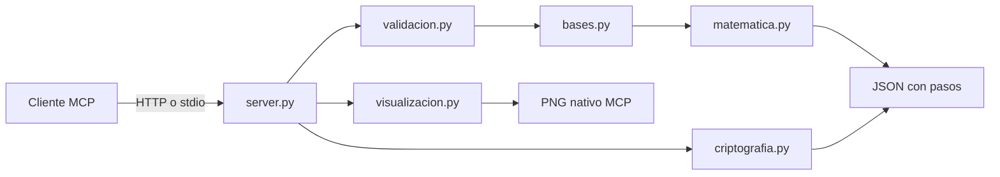

# Propuesta: transformaciones lineales, invertibilidad y encriptación con matrices

**Grupo:** 05 - Universidad Nacional Mayor de San Marcos.  
**Contenido:** Álgebra lineal.  
**Entrega:** Redes, Arquitectura y Comunicaciones - Práctica.

## Objetivo

Desarrollar un servidor MCP que determine si T:V→W tiene inversa y explique el procedimiento completo: dimensiones, bases, imágenes, matriz asociada, Gauss-Jordan, reconstrucción y verificación. Se conecta el tema con una aplicación a mensajes: el cifrado Hill mediante matrices.

La propuesta desarrolla el PDF `proyecto_redes_practica (1).pdf` y el notebook `InversaTL.ipynb.txt`, y adopta la organización modular del proyecto de integración del grupo 01. Amplía el caso Rn→Rn a polinomios, matrices y bases personalizadas.

Se integra del proyecto paralelo del grupo la entrada `calcular_inversa_tl(n, regla)` y su presentación completa en Markdown y LaTeX. La adaptación reutiliza el motor matemático común, admite expresiones como `2x1+x2` y conserva las herramientas de bases, otros espacios, gráficos y cifrado Hill. El servidor no guarda un historial local: las imágenes se generan en memoria y su publicación usa el almacenamiento del laboratorio.

## Espacios y coordenadas

Se soportan Rn, Pn y Mpxq(R), con dimensiones n, n+1 y p*q. Los polinomios usan coeficientes en {1,t,...,tⁿ}; las matrices usan entradas por filas y la base elemental Eij. La primera versión admite dimensión total de 1 a 8 y coeficientes racionales exactos, incluyendo decimales finitos. No admite coeficientes simbólicos o irracionales.

La regla o matriz de entrada representa la transformación en coordenadas canónicas. Para bases B y C con vectores como columnas:

```text
A = [T]_(C<-B) = C^(-1) M B
[T(v)]_C = A [v]_B
[T^(-1)]_(B<-C) = A^(-1)
M^(-1) = B A^(-1) C^(-1)
```

## Flujo matemático

1. Identificar espacios, dimensiones y orden de coordenadas.
2. Validar linealidad de la regla o dimensiones de la matriz.
3. Generar bases canónicas o validar independencia de las bases elegidas.
4. Evaluar T en los vectores de B y expresar imágenes en C.
5. Construir A y obtener su rango.
6. Si las dimensiones son distintas, explicar por qué no existe inversa global bilateral.
7. Si A es cuadrada, calcular det(A). Si es cero, informar que no es invertible.
8. Si det(A)≠0, transformar [A|I] en [I|A⁻¹] con Gauss-Jordan, registrando cada operación.
9. Reconstruir T⁻¹ como vector, polinomio o matriz del dominio original.
10. Comprobar T⁻¹∘T=I y T∘T⁻¹=I.
11. Para R²/R³, producir una imagen con la base y un vector antes y después de T.

## Casos de demostración

- PDF: T:R2→R2, T(x1,x2)=(2x1+x2,x1-x2), det(A)=-3, A⁻¹=[[1/3,1/3],[1/3,-2/3]].
- Notebook: T:R3→R3, T(x1,x2,x3)=(x1,x2+x3,x2-x3).
- Polinomios: T:P2→R3, T(p)=(p(0),p(1),p(2)); M=[[1,0,0],[1,1,1],[1,2,4]]. La inversa reconstruye p a partir de sus valores.
- Matrices: R6→M2x3 convierte seis coordenadas en entradas por filas; su matriz asociada puede ser I6.
- Bases personalizadas: B=[[1,1],[0,1]], C=[[1,0],[1,1]], A=C⁻¹MB.
- Sin inversa: matriz [[1,2],[2,4]] y una transformación R2→R3.

## Encriptación con matrices

Hill asigna números a letras y agrupa el mensaje en vectores columna p. Una clave entera K transforma cada bloque mediante `c = Kp mod m`; el descifrado utiliza `p = K⁻¹c mod m`.

El alfabeto predeterminado tiene 26 letras: A=0,...,Z=25. La condición de descifrado es **mcd(det(K),m)=1**. Se calcula K⁻¹ como `det(K)⁻¹ adj(K) mod m` y se verifica el producto identidad modular.

K=[[3,3],[2,5]] cifra HOLA como LGHW; K⁻¹=[[15,17],[20,9]] módulo 26 recupera HOLA. El resultado presenta cada vector, su producto, los residuos y el bloque resultante.

Se conserva la cantidad de relleno para retirar únicamente lo agregado, sin borrar X originales. El texto no se normaliza silenciosamente; alfabetos personalizados permiten Ñ o espacios. Se admiten claves 2x2, 3x3 o 4x4.

Este tema permite contrastar la inversa real con la modular: un determinante 2 es no nulo, pero no es invertible módulo 26. Hill es histórico y educativo; es vulnerable a texto conocido y no sirve para proteger información real.

## Arquitectura y herramientas MCP



Se implementan las siete herramientas propuestas en el PDF y tres para Hill: analizar_transformacion, construir_matriz_asociada, verificar_invertibilidad, hallar_inversa, mostrar_gauss_jordan, verificar_inversa, visualizar_transformacion, analizar_clave_hill, cifrar_hill y descifrar_hill.

El transporte HTTP expone `/mcp` en el puerto 8000; stdio permite uso local. El recurso `algebra://guia` explica las convenciones y el prompt `tutor_algebra` propone una secuencia de exposición. Los cálculos no requieren un modelo de lenguaje ni una API pagada. `cli.py demo` genera un reporte HTML autocontenido.

## Grupo, empaquetado y verificación

Los seis integrantes están registrados en [Integrantes](../../Integrantes/README.md), junto con sus fichas.

El proyecto incluye Dockerfile, Compose con límite de memoria, nombre inyectado por `LAB_CONTAINER_NAME` y red `lab_net`, dependencias fijadas y ejemplos. Las pruebas se conservan en la copia de desarrollo, dentro de `test/` y excluidas por su único `.gitignore` global, conforme a la indicación del profesor. Esta entrega no incluye las pruebas locales. El despliegue corresponde al profesor y genera las rutas públicas.

Los gráficos se devuelven como imágenes nativas MCP y, cuando el laboratorio proporciona `LAB_IMG_BUCKET` y `LAB_PUBLIC_IMG_URL`, se publican en su SeaweedFS mediante `storage.py`. El cálculo y la imagen nativa siguen disponibles si el almacenamiento no responde.

Las pruebas utilizan casos conocidos y propiedades matemáticas: ambas identidades, cambio de base, polinomios y matrices, casos sin inversa, claves no invertibles, relleno y una sesión real del protocolo MCP.

El resultado combina programación, álgebra lineal, aritmética modular y comunicación cliente-servidor con procedimientos revisables paso a paso.
